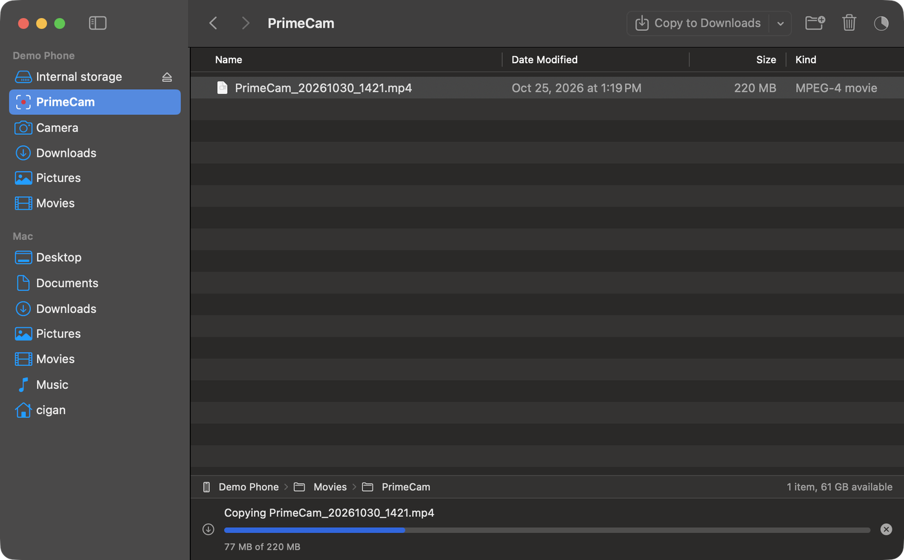

# Droplane

[](https://github.com/ryabinski-labs/droplane/actions/workflows/pr-validation.yml)
[](https://scorecard.dev/viewer/?uri=github.com/ryabinski-labs/droplane)
[](LICENSE)
[](https://github.com/ryabinski-labs/droplane/releases)


Droplane is a free, open-source Mac app that copies files between an Android phone and your Mac over USB: an Android File Transfer alternative that looks and works like Finder. Browse the phone in a sidebar and list view, drag files out to the Desktop, drag files in from Finder, and see progress on every copy. The result: your phone's photos and videos land in any Mac folder without a cloud account or developer tools.

**[Download the latest release](https://github.com/ryabinski-labs/droplane/releases/latest)** (Apple Silicon Macs) · [How to install](#install) · [Quickstart](#quickstart)

## At a Glance

| Question | Answer |
| --- | --- |
| What is it? | A native macOS app (SwiftUI and AppKit) that talks to Android over MTP, the USB "File transfer" mode. |
| Who is it for? | Anyone who needs to move photos, videos, or documents between an Android phone and a Mac. |
| What problem does it solve? | Macs can't open an Android phone's storage on their own, and the usual workarounds are dated or need developer tools. |
| What is the outcome? | The phone's folders appear in a Finder-style window, and dragging files moves them, with progress and a Retry button if a copy fails. |
| Project status | Pre-release. Downloads are ad-hoc signed, not yet signed with an Apple Developer ID or notarized, so macOS asks you to approve the first launch (steps below). |
| License | MIT (see [LICENSE](LICENSE)). Bundled libmtp and libusb are LGPL-2.1-or-later (see [THIRD_PARTY_NOTICES.md](THIRD_PARTY_NOTICES.md)). |



## Use This When

- You want to copy photos and videos off an Android phone without a cloud account or a cable-to-computer app from the phone maker.
- You want drag and drop from the phone into any Finder folder.
- You want an app that makes no network connections and collects nothing.

## Not a Fit When

- You want to copy files wirelessly. Droplane works over a USB cable only.
- You use an iPhone. This app is for Android.
- You need to sync, back up, or mirror the whole phone. Droplane copies the files you choose.
- You run macOS 13 or older. Droplane needs macOS 14 or later.
- Another phone manager (Android File Transfer, Samsung Smart Switch) is open. Only one app can use the phone at a time, so quit it first.

### Alternatives

| | Droplane | [OpenMTP](https://openmtp.ganeshrvel.com/) | [MacDroid](https://www.macdroid.app/) |
| --- | --- | --- | --- |
| Price | Free | Free | Paid, with a free trial |
| License | MIT, open source | MIT, open source | Closed source |
| Runs on | macOS 14+ | macOS 10.14+ | macOS |
| Connection | USB | USB | USB and Wi-Fi |
| Look and feel | Native SwiftUI, Finder-style, drag to Finder folders | Two-pane transfer window | Mounts the phone as a drive |

Facts about other apps come from their own websites and may change; check them before you decide. `adb pull` suits developers who already have Android's platform tools.

## Features

- Finder-style window: sidebar, sortable list with Name, Date Modified, Size and Kind, path bar, back and forward.
- Shortcuts to the phone's Camera, Downloads, Pictures, Movies and Documents folders.
- A PrimeCam shortcut that appears when the phone has a Movies > PrimeCam folder. PrimeCam's guide to [copying videos to a Mac](https://primecam.app/import.html#copy) walks through it.
- Drag files out of the phone into Finder, and drag files from Finder onto the phone. Folders copy with everything inside.
- Copy with ⌘C and ⌘V, or with the "Copy to Downloads" toolbar button.
- Name conflicts always ask: Replace (or Merge for folders), Keep Both, or Skip, with Apply to All. Replaced Mac files go to the Trash.
- A transfer queue with progress, Stop and Retry. Cancelling never leaves a half-copied file under the real name.
- Rename, new folder and delete on the phone. Delete asks first and is permanent.
- A Demo Phone so you can try the app without a device.

## Requirements

- macOS 14 (Sonoma) or later.
- An Android phone with USB set to File transfer (MTP). On Pixel phones this is "File transfer / Android Auto".
- Downloads are for Apple Silicon Macs. Intel Macs can build from source: Xcode 16 or later with its Swift toolchain, and [Homebrew](https://brew.sh) for libmtp.

## Install

### Download the app (no developer tools needed)

You need an Apple Silicon Mac (M1 or later) on macOS 14 or newer. The download is built for Apple Silicon only; on an Intel Mac, [build from source](#build-from-source).

1. Open the [latest release](https://github.com/ryabinski-labs/droplane/releases/latest) and download `Droplane-<version>-arm64.zip` from Assets.
2. Double-click the zip to unzip it, then drag **Droplane** into your **Applications** folder.
3. Open Droplane. macOS will say it can't verify the app, because this pre-release is not notarized yet. Approve it once:
   - **macOS 15 (Sequoia) or later:** click **Done**, open **System Settings > Privacy & Security**, scroll to **Security**, click **Open Anyway** next to "Droplane", then confirm with your password or Touch ID.
   - **macOS 14 (Sonoma):** Control-click Droplane in Applications, choose **Open**, then click **Open**.
4. Plug in your phone, unlock it, and choose **File transfer** in the USB notification. The phone appears in the sidebar within a few seconds.

Only approve apps you trust. To check that the download is the file this repository built, compare its checksum with `SHA256SUMS.txt` from the same release:

```sh
shasum -a 256 -c SHA256SUMS.txt --ignore-missing
gh attestation verify Droplane-<version>-arm64.zip --repo ryabinski-labs/droplane
```

Signed and notarized builds, which open with no warning, and a Homebrew cask are planned but not available yet (see [Project status](#project-status)).

### Build from source

You need Xcode 16 or later with its Swift toolchain, and [Homebrew](https://brew.sh) for libmtp. This works on Apple Silicon and Intel Macs.

```sh
brew install libmtp
git clone https://github.com/ryabinski-labs/droplane.git
cd droplane
./scripts/make-app.sh
open build/Droplane.app
```

Expected result: the Droplane window opens. A local build is ad-hoc signed, so macOS may ask you to approve the first launch the same way.

## Quickstart

1. Connect the phone and unlock it.
2. Pick Camera (or any folder) in the sidebar.
3. Drag photos to a Finder window or the Desktop, or select them and press **Copy to Downloads**.
4. Watch progress on the toolbar's Transfers button, or open the Transfers window.

No phone at hand? Open the app with nothing plugged in and click **Try the Demo Phone**.

If the phone does not show up, see [SUPPORT.md](SUPPORT.md).

## Usage

- Copy with ⌘C and ⌘V, or drag between a phone folder and Finder.
- Show hidden files with ⇧⌘. and refresh with ⌘R.
- Go back and forward with ⌘[ and ⌘], and up one folder with ⌘↑.
- Right-click a phone item for Copy to…, Rename, and Delete.

## Privacy

Droplane has no telemetry, analytics, or accounts, and it makes no network connections. File names and contents stay on your Mac and your phone.

## Project status

Pre-release. The remaining work before a notarized release:

- Developer ID signing and notarization (needs the maintainers' Apple certificate), so the first-launch approval goes away.
- A Homebrew cask, once releases are notarized.
- Intel (universal) builds.
- A signed update channel.
- Thumbnails and an icon view.

The behavior is specified in [docs/prd/android-file-copier.md](docs/prd/android-file-copier.md) and the test plan in [tdd/android-file-copier.tdd.md](tdd/android-file-copier.tdd.md). The 30 scenario tests in `Tests/` are placeholders written first (test-driven); they currently pass only as expected failures and are being turned into real tests.

## Development

```sh
brew install libmtp
swift build          # build the app and libraries
swift test           # run the tests
./scripts/make-app.sh  # package build/Droplane.app
```

The code is split into `TransferCore` (device protocol, conflict and name rules, a demo device), `MTPBridge` (libmtp bindings), and `Droplane` (the SwiftUI and AppKit app). See [CONTRIBUTING.md](CONTRIBUTING.md).

## Support

Questions and bugs: open an issue. See [SUPPORT.md](SUPPORT.md). This is a volunteer project with no response-time guarantee.

## Security

Report vulnerabilities privately, as described in [SECURITY.md](SECURITY.md).

## License

MIT. See [LICENSE](LICENSE). libmtp and libusb are bundled as dynamic libraries under the LGPL; see [THIRD_PARTY_NOTICES.md](THIRD_PARTY_NOTICES.md).

Android is a trademark of Google LLC. Droplane is an independent project and is not affiliated with or endorsed by Google.
